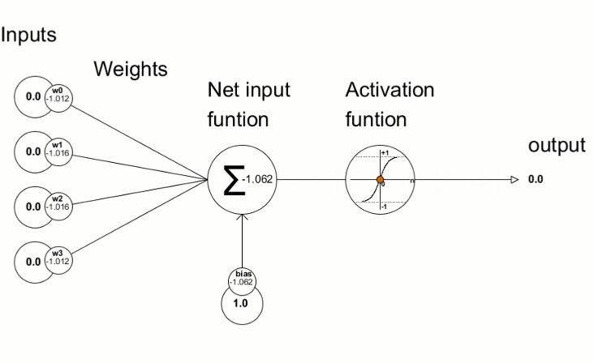

# NeuroMath

**The mathematical engine of neural networks, engineered from first principles in pure Python and NumPy.**

[](https://www.python.org/)
[](https://numpy.org/)
[](https://github.com/ARUNAGIRINATHAN-K/NeuroMath/actions)
[](LICENSE)
[](CONTRIBUTING.md)
[](https://github.com/ARUNAGIRINATHAN-K/NeuroMath/stargazers)
[](https://github.com/ARUNAGIRINATHAN-K/NeuroMath/network/members)



## Why NeuroMath?

Modern deep learning frameworks (PyTorch, JAX, TensorFlow) abstract foundational operations behind autograd engines and opaque C++/CUDA kernels. While optimal for production training, this black-box abstraction conceals the exact calculus and linear algebra driving parameter convergence.

| Dimension | Black-Box Frameworks | NeuroMath |
| :--- | :--- | :--- |
| **Abstraction Level** | Automatic differentiation (`loss.backward()`) | Explicit analytical Jacobians ($\frac{\partial \mathcal{L}}{\partial W}$, $\frac{\partial \mathcal{L}}{\partial b}$) |
| **Dependencies** | Heavy multi-gigabyte runtimes (CUDA, C++ wheels) | Lightweight, standard numerical libraries (`NumPy`, `Matplotlib`) |
| **Determinism & Traceability** | Hidden memory management & computational graphs | Step-by-step tensor inspection at every forward/backward layer |
| **Learning Trajectory** | API memorization | Mathematical mechanics and first-principles mastery |

* **Zero-Abstraction Vectorization**: Every forward pass, activation function, and backward gradient is expressed via vectorized linear algebra ($Z = XW + b$).
* **Analytical Gradient Verification**: Derivatives are hand-derived via the multivariate chain rule, providing mathematical validation against numerical approximations.
* **Isolated Laboratory Architecture**: 10 decoupled modules that allow developers to inspect, isolate, and debug individual computational phases without boilerplate bloat.
* **Companion Theory Included**: Ships with an in-depth companion mathematical guide ([`Mathematics_of_ANN.pdf`](Mathematics_of_ANN.pdf)) covering linear algebra, calculus, and optimization proofs.

---



## Key Features

* **Manual Backpropagation Engine**: Full analytical implementations of gradient descent and weight updates with zero reliance on autograd frameworks.
* **Loss Landscape Geometry**: High-resolution 2D contour and 3D surface mesh generators to analyze optimization landscapes, saddle points, and local minima.
* **Inverted Dropout from Scratch**: Implementation of Bernoulli dynamic masking and inverted dropout scaling during forward and backward passes.
* **Non-Linear Decision Boundary Solving**: Multi-Layer Perceptrons (MLP) capable of solving non-linearly separable manifolds (XOR problem, custom synthetic clusters).
* **Comprehensive Activation Benchmark**: Side-by-side empirical convergence and saturation analysis comparing Sigmoid, Hyperbolic Tangent ($\tanh$), and Rectified Linear Units ($\text{ReLU}$).
* **End-to-End Multiclass Classification**: Full pipeline demonstrating Softmax output normalization and Categorical Cross-Entropy on the MNIST digit dataset.
* **Sequential Regression**: Sliding-window time series feature extraction and continuous regression modeling.

---

## Quickstart

### Prerequisites
* Python 3.9 or higher
* `pip` package manager

### 1. Clone & Set Up Environment

```bash
git clone https://github.com/ARUNAGIRINATHAN-K/NeuroMath.git
cd NeuroMath
python -m venv venv

# Windows
venv\Scripts\activate

# macOS / Linux
source venv/bin/activate
```

### 2. Install Dependencies

Install the core numerical and visualization dependencies with a single command:

```bash
pip install -r requirements.txt
```

*(Alternatively: `pip install numpy matplotlib scikit-learn tensorflow jupyter`)*

### 3. Run Your First Experiment

Run the pure NumPy feedforward network to solve the XOR classification boundary:

```bash
python 01_nn_from_scratch/main.py
```

Expected output:
```text
Epoch 0 — Loss: 0.3091
Epoch 1000 — Loss: 0.0512
Epoch 2000 — Loss: 0.0248
...
Final predictions:
[[0.038]
 [0.961]
 [0.963]
 [0.042]]
```

---

### Module Directory

| # | Module Folder | Primary Domain | Core Mathematical Principles |
| :---: | :--- | :--- | :--- |
| **01** | [`01_nn_from_scratch`](01_nn_from_scratch) | Feedforward Foundations | Matrix dot products, manual chain rule, MSE optimization |
| **02** | [`02_xor_classification`](02_xor_classification) | Non-Linearity | Hidden layer projection, non-linear hyperplanes |
| **03** | [`03_mnist_digit_recognition`](03_mnist_digit_recognition) | Multiclass Classification | Softmax normalization, categorical cross-entropy loss |
| **04** | [`04_nn_visualizer`](04_nn_visualizer) | Dynamical Systems | Decision boundary transitions, real-time plotting |
| **05** | [`05_custom_dataset_ann`](05_custom_dataset_ann) | Tabular Deep Learning | Feature scaling, continuous/discrete encoding, batch training |
| **06** | [`06_loss_landscape`](06_loss_landscape) | Optimization Geometry | Hessian intuition, convex surfaces, 3D mesh rendering |
| **07** | [`07_backprop_simulator`](07_backprop_simulator) | Analytical Calculus | Layer-by-layer intermediate Jacobian tracking |
| **08** | [`08_activation_function_analysis`](08_activation_function_analysis) | Numerical Stability | Vanishing gradient dynamics, saturation regions |
| **09** | [`09_dropout_regularization`](09_dropout_regularization) | Stochastic Regularization | Bernoulli dropout masks, inverted scaling factors |
| **10** | [`10_time_series_ann`](10_time_series_ann) | Temporal Modeling | Windowed feature lag transformation, autoregressive ANN |

---

## Activation Functions Reference

$$\begin{array}{lcccc}
\hline
\textbf{Function} & \textbf{Equation} & \textbf{Derivative } f'(x) & \textbf{Output Range} & \textbf{Typical Role} \\
\hline
\text{Sigmoid} & \sigma(x) = \frac{1}{1 + e^{-x}} & \sigma(x)(1 - \sigma(x)) & (0, 1) & \text{Binary probability output} \\
\text{Tanh} & \tanh(x) = \frac{e^x - e^{-x}}{e^x + e^{-x}} & 1 - \tanh^2(x) & (-1, 1) & \text{Zero-centered hidden layers} \\
\text{ReLU} & \max(0, x) & \mathbf{1}_{x > 0} & [0, \infty) & \text{Deep networks (sparse activation)} \\
\text{Softmax} & \frac{e^{z_i}}{\sum_{j} e^{z_j}} & S_i(\delta_{ij} - S_j) & (0, 1), \sum=1 & \text{Multiclass probability distribution} \\
\hline
\end{array}$$

---

## Project Roadmap

- [x] **v1.0 — Core Foundations**
  - [x] Pure NumPy forward & backward propagation engine.
  - [x] 10 standalone educational modules covering XOR to time series.
  - [x] 2D/3D loss landscape visualizer.
  - [x] Inverted dropout regularization from scratch.
  - [x] Comprehensive mathematical theory manual (`Mathematics_of_ANN.pdf`).
- [ ] **v1.1 — Advanced Optimizers**
  - [ ] Analytical implementations of Momentum, RMSprop, and Adam optimizers in pure NumPy.
  - [ ] Comparative optimizer trajectory visualizations over non-convex surfaces.
- [ ] **v1.2 — Convolution & Attention from Scratch**
  - [ ] 2D Convolution and Max-Pooling forward/backward matrix calculus.
  - [ ] Scaled Dot-Product Attention mechanism in pure NumPy.
- [ ] **v1.3 — Interactive Web Dashboard**
  - [ ] Streamlit/WebAssembly interactive parameter and loss surface visualizer.

---

## Contributing

Contributions make the open-source community an inspiring place to learn, innovate, and build. Any contributions you make are **greatly appreciated**.

Please review our [Contributing Guidelines](CONTRIBUTING.md) and [Code of Conduct](CODE_OF_CONDUCT.md) before opening a pull request.

1. Fork the Project
2. Create your Feature Branch (`git checkout -b feature/AmazingFeature`)
3. Commit your Changes (`git commit -m 'Add some AmazingFeature'`)
4. Push to the Branch (`git push origin feature/AmazingFeature`)
5. Open a Pull Request

---

## Citation

If you use NeuroMath for academic coursework, machine learning research, or educational content, please cite this repository using the following BibTeX entry (or see [`CITATION.cff`](CITATION.cff)):

```bibtex
@software{neuromath2026,
  author = {Arunagirinathan K},
  title = {NeuroMath: The Mathematical Engine of Neural Networks from First Principles},
  year = {2026},
  url = {https://github.com/ARUNAGIRINATHAN-K/NeuroMath}
}
```

---

## License

Distributed under the MIT License. See [`LICENSE`](LICENSE) for full details.

---

<div align="center">
  <sub>Engineered by <a href="https://github.com/ARUNAGIRINATHAN-K">ARUNAGIRINATHAN-K</a>. If you found this repository insightful, consider giving it a ⭐ star on GitHub.</sub>
</div>
